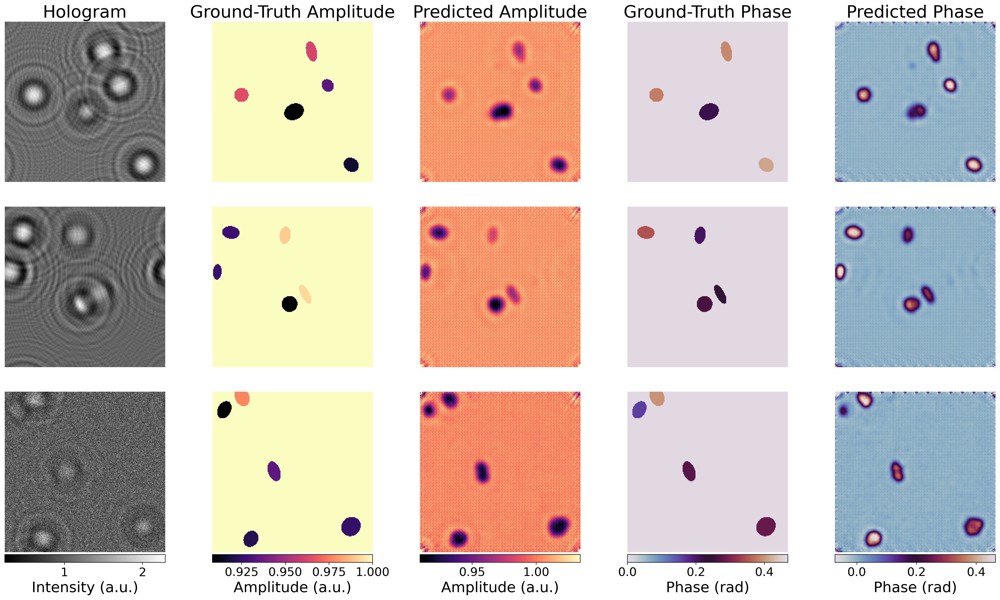
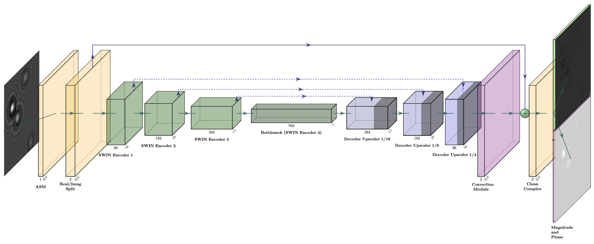

<div align="center">

# HoloPASWIN

**Robust Inline Holographic Reconstruction via Physics-Aware Swin Transformers**

[](https://arxiv.org/abs/2603.04926)
[](https://huggingface.co/gokhankocmarli/holopaswin-v3)
[](https://huggingface.co/datasets/gokhankocmarli/inline-digital-holography-v3)
[](https://huggingface.co/spaces/gokhankocmarli/holopaswin-v3-space)
[](https://electricalgorithm.github.io/holopaswin/)



*HoloPASWIN recovers clean phase and amplitude mappings from a single intensity hologram, directly eliminating twin-image artifacts.*
</div>

## Overview

> **🤗 Try the interactive Web Demo on Hugging Face Spaces:** [gokhankocmarli/holopaswin-v3-space](https://huggingface.co/spaces/gokhankocmarli/holopaswin-v3-space)

HoloPASWIN is a deep learning framework designed to eliminate the twin-image artifact in inline digital holography. While inline holography is an effective lensless imaging technique, the loss of phase information during capturing causes an out-of-focus duplicate (twin-image) to permanently degrade the reconstructed object.

This repository implements a Physics-Aware Swin Transformer U-Net that inherently corrects and removes these artifacts. By integrating a forward physics model (the Angular Spectrum Method) with the Swin Transformer's global attention, HoloPASWIN achieves robust phase recovery and high structural fidelity across varying noise levels and distances.


## Network Architecture



HoloPASWIN utilizes a U-shaped architecture based on Swin Transformer blocks. The model first processes an input intensity hologram using the backward Angular Spectrum Method (ASM) to obtain an initial, artifact-heavy complex field. A 4-stage Swin Encoder-Decoder network then extracts multi-scale features to predict a residual correction. By adding this correction to the initial field and training with both frequency-domain constraints and a physics-based forward propagation loss, the network robustly recovers the clean phase and amplitude.


## Installation

This project uses [uv](https://github.com/astral-sh/uv) for fast and reliable dependency management.

1.  **Install uv** (if not already installed):
    ```bash
    curl -LsSf https://astral.sh/uv/install.sh | sh
    ```

2.  **Sync Dependencies**:
    Navigate to the `holopaswin` directory and run:
    ```bash
    uv sync
    ```
    This creates a virtual environment and installs all locked dependencies from `uv.lock`.

## Usage

Every workflow runs through the `holopaswin` command; `holopaswin COMMAND --help` lists all options. Datasets come from [hologen](../hologen), and each one carries its geometry (wavelength, pixel size, distance, objective NA, image size) in the `recipe.toml` hologen saves with it, so no command takes these values as options.

### Paper datasets

`recipes/` holds the hologen recipe of every dataset used in the paper. Each file sets only what differs from hologen's default recipe; the generated folder's `recipe.toml` holds the complete recipe.

| Set | Command | Seeds | Holograms |
|---|---|---|---|
| training | `hologen generate --recipe recipes/train.toml --output train` | 10000-17999 | 8,000 |
| training with distance errors | `hologen generate --recipe recipes/train-z-augmented.toml --output train-z-augmented` | 10000-17999 | 8,000 |
| test | `hologen generate --recipe recipes/test.toml --output test` | 200000-200999 | 1,000 |
| phase x 2 | `hologen generate --recipe recipes/test-phase.toml --output test-phase` | 200000-200999 | 1,000 |
| absorbing red blood cells | `hologen generate --recipe recipes/test-absorption.toml --output test-absorption` | 200000-200999 | 1,000 |
| low light | `hologen generate --recipe recipes/test-low-light.toml --output test-low-light` | 200000-200999 | 1,000 |
| strong speckle | `hologen generate --recipe recipes/test-strong-speckle.toml --output test-strong-speckle` | 200000-200999 | 1,000 |
| dense | `hologen generate --recipe recipes/test-dense.toml --output test-dense` | 300000-300399 | 400 |
| distance sweep | see [Distance sweep](#distance-sweep) | 900000-900199 | 200 per offset |

The phase, absorption, low-light and strong-speckle sets share the test set's seeds and groups, so hologram i of each holds the same cells as test hologram i and differs in one property. The phase, absorption, strong-speckle and dense recipes change settings the exposures were calibrated for, so `hologen generate` warns for them; they keep the training exposures on purpose.

### Training

Training is configured by a TOML file, like a hologen recipe. Write the defaults, edit them, and train; options override the file:

```bash
uv run holopaswin config --output config.toml
uv run holopaswin train ../hologen/dataset --config config.toml --output runs/holopaswin
uv run holopaswin train ../hologen/dataset --architecture unet --output runs/unet
```

The configuration sets the network (`holopaswin`, `unet`, `resnet_unet` or `hrnet`), epochs, batch size, learning rate, split seed, the weights of every loss term and whether the physics loss uses each hologram's recorded distance. A loss ablation is therefore a set of small configuration files trained one after another:

```bash
for config in ablations/*.toml; do
    uv run holopaswin train ../hologen/dataset --config $config --output runs/$(basename $config .toml)
done
```

Each run folder holds the best model (`model.pth`), the state for continuing (`last.pth`), the configuration, the dataset's `recipe.toml` and the loss per epoch (`history.csv`). `--resume` continues a run, and `scripts/plot_training_curves.py --history-csv runs/holopaswin/history.csv` plots it.

### Evaluation

Score trained runs and classical baselines (`asm` for back-propagation, `gs50` and `gs100` for Gerchberg-Saxton, `lf50` and `lf100` for Latychevskaia-Fink, `tv50` and `tv100` for constrained complex total variation) on a test set:

```bash
uv run holopaswin evaluate ../hologen/test --model holopaswin=runs/holopaswin --model unet=runs/unet --baseline asm --output results/main
```

Every hologram is scored with the metrics of the paper's tables. `summary.json` gives, per metric and method, the mean and standard deviation and the median with a bootstrap interval, overall, per object family and per noise configuration. Paired Wilcoxon tests compare the first two methods (the models in the order given, then the baselines), with a Holm correction over the groups of each metric and grouping, not across metrics.

### Figures and timing

```bash
uv run holopaswin figure ../hologen/test --samples 0,5,9 --model holopaswin=runs/holopaswin --baseline asm --error --zoom 80,80,48
uv run holopaswin benchmark ../hologen/test --model holopaswin=runs/holopaswin --architecture unet --baseline asm --baseline lf100 --batch-size 1 --batch-size 16
```

`figure` draws the hologram, the phase of every method and the true phase per sample on one colour scale. `benchmark` times every method with one protocol: on the same holograms of the test set, on one device, for the same batch sizes and after the same warm-up, from the normalised hologram on the device to the reconstructed field. It also times the whole path from a stored hologram (reading, normalising, reconstructing). `benchmark.json` records the protocol next to the timings, the parameter count of each method, and the time of every timed pass and frame, so confidence intervals can be computed. Untrained networks (`--architecture`) take as long as trained ones.

### Distance sweep

`holopaswin sweep` measures how reconstructions degrade when the distance a model assumes is wrong. Generate one test set per distance offset from `recipes/sweep.toml`, all from the same seeds, then score the models on them:

```bash
for dz in -10 -8 -6 -4 -2 -1 0 1 2 4 6 8 10; do
    hologen generate --recipe recipes/sweep.toml --output sweep/offset_$dz --z-offset $dz --no-visualization
done
uv run holopaswin sweep sweep --model standard=runs/holopaswin --model z_augmented=runs/zaug --output results/z_sweep
```

Every model is told only the nominal distance. Two references need no network: back-propagation at the nominal distance and, as an oracle, at the true one. The command writes `per_sample.csv`, `summary.json` (per metric, object family and offset: medians with bootstrap intervals and a paired Wilcoxon test between the first two models) and `z_sweep.png`. Run `holopaswin sweep --help` for all options.

### Development

Install with the development extra, `uv sync --extra dev`, and run the tests with `uv run pytest`. Every run measures branch coverage of the package and fails below 97 percent; add `--no-cov` when running a single test file.

This repository includes pre-commit hooks that automatically run code quality checks (`ruff` and `mypy`) before each commit. To install them:

```bash
./scripts/install-hooks.sh
```

If any check fails, the commit will be blocked.

## Citation

If you find this code, dataset, or model useful for your research, please cite our paper:

```bibtex
@misc{kocmarli2026holopaswinrobustinlineholographic,
      title={HoloPASWIN: Robust Inline Holographic Reconstruction via Physics-Aware Swin Transformers}, 
      author={Gökhan Koçmarlı and G. Bora Esmer},
      year={2026},
      eprint={2603.04926},
      archivePrefix={arXiv},
      primaryClass={eess.IV},
      url={https://arxiv.org/abs/2603.04926}, 
}
```
